<p align="center">
  
</p>

<p align="center">
  <a href="#-install"></a>
  <a href="LICENSE"></a>
  <a href="icon-pack/LICENSE"></a>
  
  <a href="https://github.com/Karthus3560/skill-studio/stargazers"></a>
</p>

<p align="center">
  <b>You have 200 skills installed. You use maybe five.</b><br>
  Skill Studio puts every Claude Code skill you own in a beautiful panel beside the chat:<br>
  searchable, filterable, explained in plain words, and one click from your prompt.
</p>

<p align="center">
  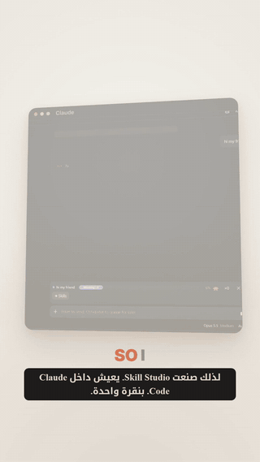
  <br>
  <sub>🎬 <a href="media/skill-studio-reel.mp4">Watch the full 60-second reel</a> (with voice-over and English / Arabic captions)</sub>
</p>

---

## ✨ Why

Skills make Claude Code powerful, but they're invisible. You type `/`, scroll a wall of names, and the one skill that would have saved your afternoon stays **buried**.

**Skill Studio** turns that wall into a place you'll actually browse:

| | |
|---|---|
| 🔎 **Find it** | Search by name or by what a skill does. Filter by Video, Voice, Design, Marketing, Docs, Code, Data, Writing or Other. |
| 💡 **Understand it** | Every skill gets a **plain-English description** (12 words max) and a **matching clay icon**, written by Claude the first time it sees the skill, then cached. |
| ➕ **Use it** | Hit **+** and `/skill-name` lands **right where your cursor is**: mid-sentence, without losing a word. Stack several skills in one prompt. |
| ⭐ **Make it yours** | Star favourites, keep recent ones on top, read everything in **Arabic**, rewrite or hand-edit any description, icon or category. |

---

## 📸 A look inside

<table>
  <tr>
    <td align="center">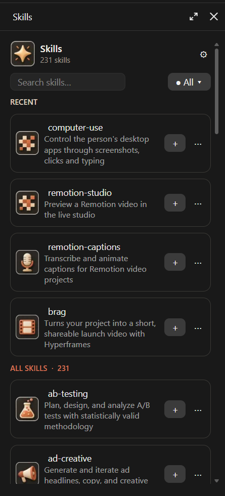<br><sub><b>Home</b>: recent skills on top</sub></td>
    <td align="center">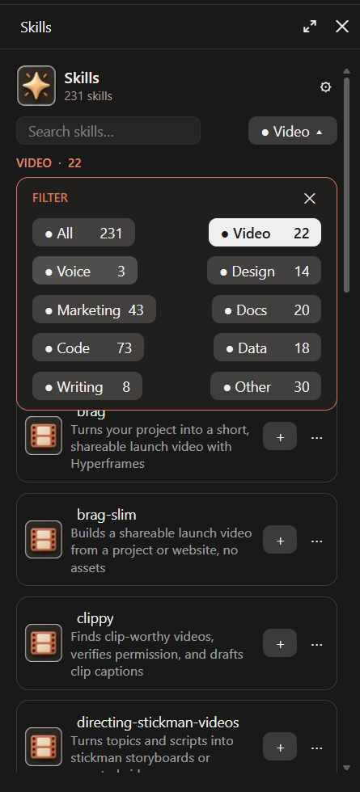<br><sub><b>Filter</b>: one menu, every category</sub></td>
    <td align="center">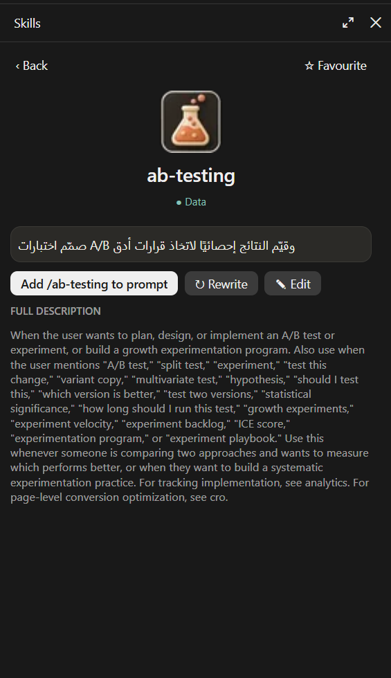<br><sub><b>Details</b>: add, rewrite, edit, favourite</sub></td>
  </tr>
  <tr>
    <td align="center">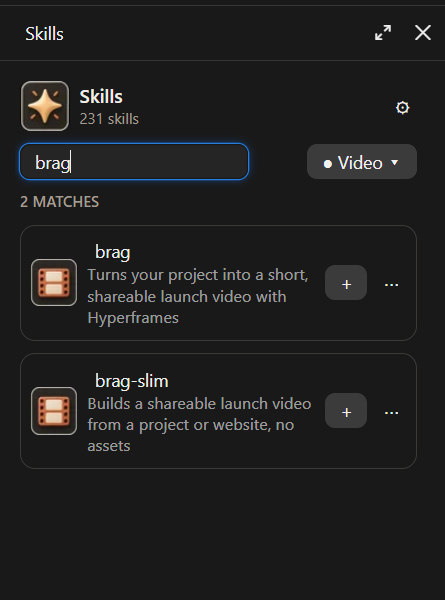<br><sub><b>Search</b>: by name or meaning</sub></td>
    <td align="center">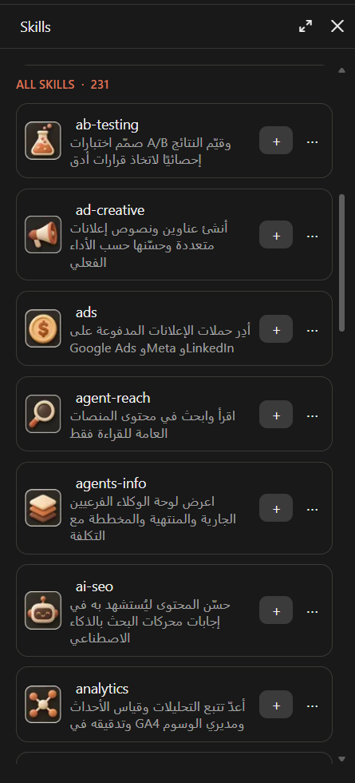<br><sub><b>العربية</b>: descriptions in Arabic</sub></td>
    <td align="center">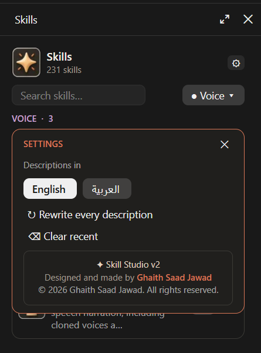<br><sub><b>Settings</b>: language, rewrite all, clear recent</sub></td>
  </tr>
</table>

<p align="center">
  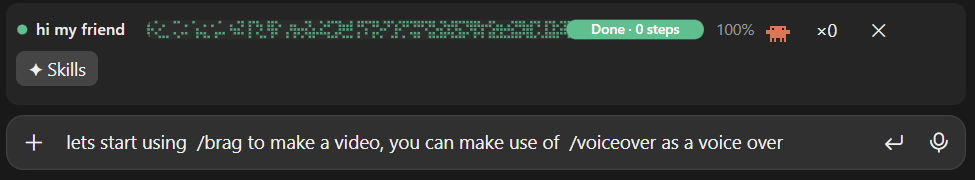<br>
  <sub>Two skills, one sentence: <code>/brag</code> and <code>/voiceover</code> added at the cursor.</sub>
</p>

---

## 🚀 Install

> **Needs Claude Code with mods (function hooks) support.** Tested on Claude Code **2.1.317** (November 2026), in the desktop app's Code tab and in the terminal.

### Option A: in a terminal (Claude Code CLI)

At the Claude Code prompt:

```
/plugin install skill-studio --marketplace Karthus3560/skill-studio
```

Answer **`y`** to add the marketplace, then pick the **user** scope so it works in every project.

Or from your shell:

```bash
claude plugin install skill-studio --marketplace Karthus3560/skill-studio
```

### Option B: in the Claude desktop app

The desktop Code tab doesn't run `/plugin`, so either use the shell command above, or:

1. Click **+** next to the prompt box, then **Plugins**.
2. **Add marketplace** and enter `Karthus3560/skill-studio`.
3. **Add plugin**, then choose **skill-studio**.

### Option C: run it from a clone (for hacking on it)

```bash
git clone https://github.com/Karthus3560/skill-studio.git
claude --plugin-dir ./skill-studio
```

---

## 👋 First run: send your first message

Mods run **inside** a Claude Code session, and a new chat's start screen is not a session yet. So:

1. Open a new chat, choose a folder (or keep *This computer*), and **send any first message**, even just `hi`.
2. The **✦ Skills** button appears above the prompt:

   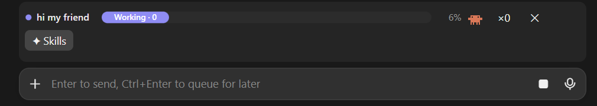

3. Click it, or type `/skill-studio`. The panel opens beside the chat.
4. During the **first minute**, Skill Studio writes a short description, icon and category for every skill in the background. The header shows `Describing skills… 40 of 231`. After that, everything is cached and opens instantly.

> Already in a chat when you installed it? Type `/reload-plugins`, or start a new chat.

---

## 🧭 Using it

| Do this | What happens |
|---|---|
| Click **✦ Skills** | Opens the panel |
| Type in **Search** | Filters as you type. **Enter** adds the first match |
| **● All ▾** | Opens the filter menu over the list |
| **+** on a row | Adds `/skill` at your cursor and keeps your text |
| A skill's **name** or **⋯** | Opens its details: full description, **Add**, **↻ Rewrite**, **✎ Edit**, **☆ Favourite** |
| **⚙** | Settings: **English / العربية**, rewrite every description, clear recent |
| **⤢** (widen the panel) | Switches from a list to a grid of cards, 2 to 4 per row |

**Tips**
- Only the **first** `/skill` in a message runs as a slash command. Others you add are named in your text, and Claude reads them as skills to use too.
- `/skill` names in your prompt are highlighted as clay chips.
- Your own edits (✎) are never overwritten by Rewrite.

---

## ⚙️ How it works

- **A Claude Code mod**: one TypeScript hooks module (`hooks/register.tsx`) that draws the button above the prompt and the panel beside the chat, using Claude Code's own UI elements.
- **Descriptions** come from `hooks/gen.ts`. For each new or changed skill it reads the skill's `SKILL.md`, then asks a **small, fast model (Haiku)** through **your own Claude Code session** for one plain sentence, an icon name and a category, in batches of 10 (about 24 short calls for 231 skills). Results are cached on your machine, so this happens once. Arabic is written only if you switch to it, also once.
- **Nothing leaves your machine** except those model calls, which go through your existing Claude Code connection. There are no other servers, no telemetry and no accounts.
- **Icons** are embedded in the mod as tiny WebP images (`hooks/clay.ts`), so there are no network requests and no setup.

---

## 🎨 Free icon packs

The repo includes **two 48-icon packs** for your own projects, in `icon-pack/`: **Clay**, the set Skill Studio uses, and **Cozy Neon**. Each comes at 256 px and 128 px, plus the original sheets.

<p align="center">
  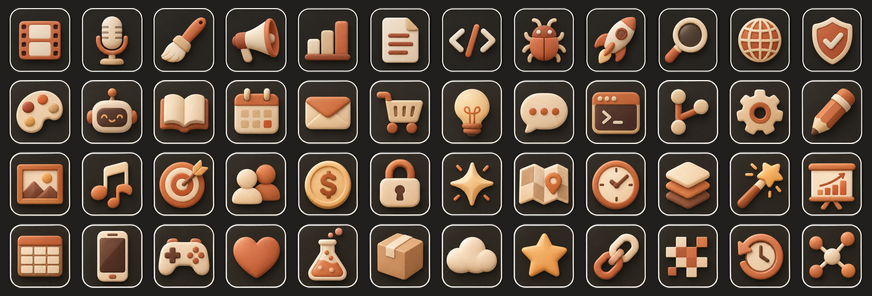<br>
  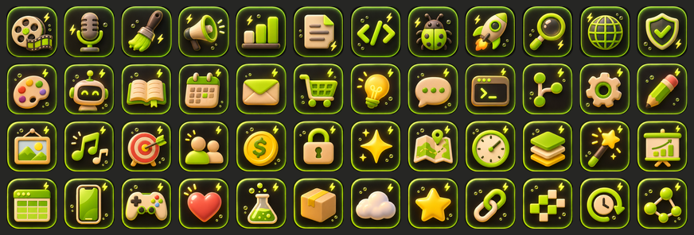
</p>

Free under **CC BY 4.0**: use them anywhere, commercial projects included, with a credit line. See [`icon-pack/README.md`](icon-pack/README.md).

---

## 🧹 Uninstall

```bash
claude plugin uninstall skill-studio@skill-studio
```

---

## ❓ Troubleshooting

<details>
<summary><b>I don't see the ✦ Skills button</b></summary>

Send a first message in the chat: the new-chat screen isn't a running session yet. If you installed it mid-chat, run `/reload-plugins` or open a new chat. Check that it's enabled with `claude plugin list`.
</details>

<details>
<summary><b>The header says "Descriptions paused"</b></summary>

A model call failed (for example, you were offline). Press **⚙ → Rewrite every description**, or **↻** on a single skill, to try again.
</details>

<details>
<summary><b>Icons don't show in the terminal</b></summary>

The terminal can't draw images, so you get the text version there. Icons appear in the desktop app.
</details>

---

## 📜 Terms of use

- ✅ **Use it**: free, for personal and commercial work.
- ✅ **Change it**: modify anything you like.
- ✅ **Fork it**: make your own version. Please **fork this repo** rather than re-uploading it, so improvements can flow back.
- ✅ **Share it**: pass it on, as long as you keep the copyright notice and the license.
- 🙏 **Credit**: keep the credit to **Ghaith Saad Jawad** (in Settings and in `LICENSE`).
- 🎨 **Icons**: CC BY 4.0, so credit the author when you use them.
- ⚠️ **No warranty**: provided as-is.

Code: [MIT](LICENSE) · Icons and media: [CC BY 4.0](icon-pack/LICENSE)

---

## 🤝 Contributing

Pull requests are welcome. Fork, branch, test with `claude plugin validate` and `claude plugin test`, then open a PR. See [CONTRIBUTING.md](CONTRIBUTING.md).

---

<p align="center">
  <b>If Skill Studio helps you, please ⭐ star the repo.</b> It helps other Claude Code users find it.
</p>

<p align="center">
  <a href="https://star-history.com/#Karthus3560/skill-studio&Date">
    
  </a>
</p>

<p align="center">
  Designed and made by <b>Ghaith Saad Jawad</b><br>
  <sub>#ClaudeCode #ClaudeSkills #ClaudeCodeMods #Anthropic #Claude #AI #AITools #DeveloperTools #Productivity #AgentSkills</sub>
</p>
