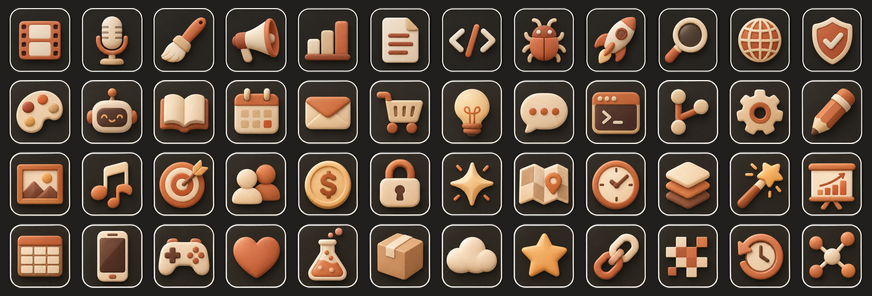
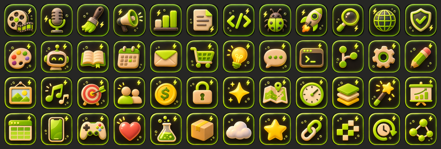

# Skill Studio Icon Packs

Two matching sets of **48 icons**, free to use under **CC BY 4.0** (credit Ghaith Saad Jawad).

| Pack | Look | Folders |
|---|---|---|
| **Clay** | Warm terracotta, cream and sand clay on charcoal tiles. The set Skill Studio uses. | `clay/256`, `clay/128`, `clay/sheets` |
| **Cozy Neon** | Chunky clay with a lime energy-drink glow and little lightning sparks. | `cozy-neon/256`, `cozy-neon/128`, `cozy-neon/sheets` |




## What's inside

- `256/` and `128/`: one transparent-corner PNG per icon, named by what it shows.
- `sheets/`: the four original 1254 × 1254 sheets (12 icons each), for re-cutting at other sizes.

## Icon names (same in both packs)

`film` `mic` `brush` `megaphone` `chart` `doc` `code` `bug` `rocket` `search` `globe` `shield`
`palette` `robot` `book` `calendar` `mail` `cart` `bulb` `chat` `terminal` `branch` `gear` `pencil`
`image` `music` `target` `users` `dollar` `lock` `sparkle` `map` `clock` `layers` `wand` `slides`
`table` `phone` `game` `heart` `flask` `box` `cloud` `star` `link` `pixel` `backup` `graph`

## Credit line

```
Icons: "Skill Studio Icon Pack" by Ghaith Saad Jawad (CC BY 4.0)
https://github.com/Karthus3560/skill-studio
```
